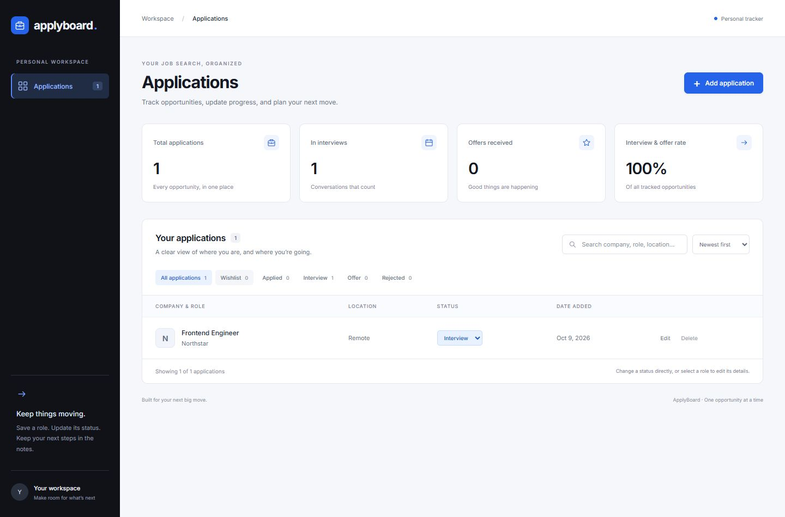

# ApplyBoard

A MERN application for tracking job applications. Save roles, update their status, and keep notes in one place.



[Kanban board](docs/kanban.png) · [Analytics view](docs/analytics.png)

## Features

- Create, edit, and delete applications with company, role, location, posting URL, applied date, and notes.
- Move opportunities through Wishlist, Applied, Interview, Offer, and Rejected.
- Switch between a list and a Kanban board. Drag cards between stages, or use the status menu on touch devices and with a keyboard. Status changes persist after the API confirms the update.
- View current pipeline counts, active applications, and weekly application activity across eight weeks. Analytics use all records, regardless of search filters; weekly totals use the saved applied date and exclude wishlist entries, future dates, and undated records.
- Search companies, roles, and locations; combine search with status filters.
- Dashboard totals and interview/offer rate derived from saved records.
- Schedule interviews with a date, local time, and preparation notes; download a one-hour calendar event (`.ics`).
- Track up to ten interview rounds per application, each with its own date, preparation/feedback, and Scheduled, Completed, or Cancelled outcome.
- View the latest 50 activity entries per application, recorded by the API when details, status, interviews, or follow-ups change.
- Set follow-up dates and next steps. The agenda highlights today’s and overdue follow-ups, and lets you mark them complete.
- MongoDB persistence, server-side validation, accessible forms, responsive layout, loading and error states.
- Integration tests exercise a real isolated MongoDB process; GitHub Actions runs tests and the production build.

## Technologies

React 19, Vite, JavaScript ES modules, Node.js, Express 5, MongoDB, Mongoose, Zod, Helmet, Supertest, and Node's test runner. pnpm manages dependencies with a committed lockfile.

## Setup and installation

Prerequisites: Node.js 22.13 or newer, pnpm 11.25.0, and MongoDB 7+ (local, Docker, or MongoDB Atlas).

```sh
git clone https://github.com/kevingerard2819/applyboard-mern.git
cd applyboard-mern
pnpm install --frozen-lockfile
```

Copy `.env.example` to `.env` and configure `MONGODB_URI`. For example:

```env
MONGODB_URI=mongodb://127.0.0.1:27017/applyboard
PORT=4000
```

With Docker installed, start MongoDB using `docker compose up -d`. For Atlas, replace `MONGODB_URI` with your connection string and configure database access/network access in Atlas. Keep credentials in `.env`; it is ignored by Git.

## Run the application

```sh
pnpm dev
```

Open **http://127.0.0.1:5173**. Vite proxies `/api` to Express at port 4000. Optional: `pnpm seed` adds four fictional examples only when the database is empty.
Keep `PORT=4000` when using the development proxy.

### No MongoDB installed?

```sh
pnpm dev:local
```

This downloads and starts a **real MongoDB server** and launches the API and frontend. The first run needs internet access and may take a few minutes. Data persists locally in `.cache/mongo-data`. Stop with Ctrl+C. This helper is for local development, and does not need a `.env` connection string.

### Production build

```sh
pnpm build
pnpm start
```

With a configured MongoDB connection, Express serves the built React app and API at **http://127.0.0.1:4000**.

### Tests

```sh
pnpm test
```

Tests download a MongoDB binary on first run, start an isolated test database, and clean it up afterward. They cover persistence and CRUD, defaults and trimming, invalid dates/URLs, operator injection, invalid IDs, literal search, filters, and JSON error responses.

Client tests also cover connection failures, timeouts, request cancellation, and unexpected server responses. Run `pnpm format` to format the whole repository, or `pnpm format:check` to check it without changing files.

## Architecture

```text
client/                 React dashboard, form, API client, CSS
server/app.js           Express routes, validation, errors, static hosting
server/index.js         Database connection and server lifecycle
server/models/          Mongoose application model
server/validation.js    Strict schemas for creation and partial updates
server/test/            MongoDB integration tests
shared/statuses.js      Status values used by the client and server
scripts/dev-local.js    Persistent local MongoDB development helper
.github/workflows/      CI
```

React stores a local copy of server data and updates it only after a successful mutation. Express explicitly validates and selects allowed fields before passing data to Mongoose. Status changes use partial updates so notes and other fields remain intact. The UI computes counts from the full collection, so filtering does not change dashboard totals.

Interview times are stored as ISO timestamps and displayed in the device’s local time zone. Follow-up dates are calendar dates, so they do not shift between time zones. The agenda refreshes each minute while open and excludes Offer and Rejected applications. Completing a follow-up clears its date and next step; scheduling a new one uses the same application form. Reminders appear in the app, with no email or background notifications. Calendar events default to a one-hour duration, which can be edited in your calendar.

Completed and cancelled rounds remain in the application but are excluded from upcoming interviews. Each round has a stable identifier and a separate calendar event. Older single-interview records appear as an existing round and are converted when saved, with no manual database migration required. Activity history is maintained by the server and cannot be supplied or edited through API input. It starts with new changes for records created before this feature and is removed when the application is deleted.

| Method | Endpoint                                  | Purpose                |
| ------ | ----------------------------------------- | ---------------------- |
| GET    | `/api/health`                             | Database readiness     |
| GET    | `/api/applications?q=text&status=Applied` | List/search/filter     |
| POST   | `/api/applications`                       | Create                 |
| PATCH  | `/api/applications/:id`                   | Update selected fields |
| DELETE | `/api/applications/:id`                   | Delete                 |

Errors use JSON with a `message`, and validation failures include field details. Posting links allow only HTTP(S); search treats user text as a literal string rather than executable regex syntax.

## AI Development Experience

I used **Code0** to help test the app and check the backend setup. My usage covered three tasks:

- **Application testing:** Checking the app’s main workflows.
- **MongoDB setup:** Working through the database connection instructions and configuration.
- **API testing:** Testing requests and checking the responses from the Express API.

See [the development notes](docs/ai-development.md) for a brief description of each task.

## Scope and tradeoffs

This is a personal, single-workspace demo with no authentication or user isolation. The server binds to localhost. All records are loaded for a small dashboard. Development requests go through Vite's API proxy, and the production server hosts the frontend and API together.

The interface uses Google Fonts with system fallbacks. No external service is required to store application data beyond the configured MongoDB instance.
